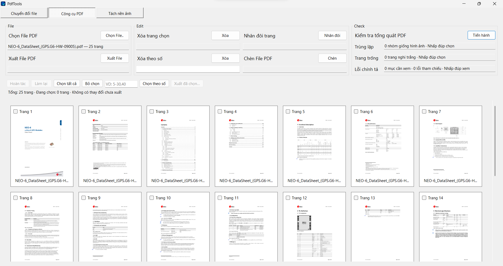
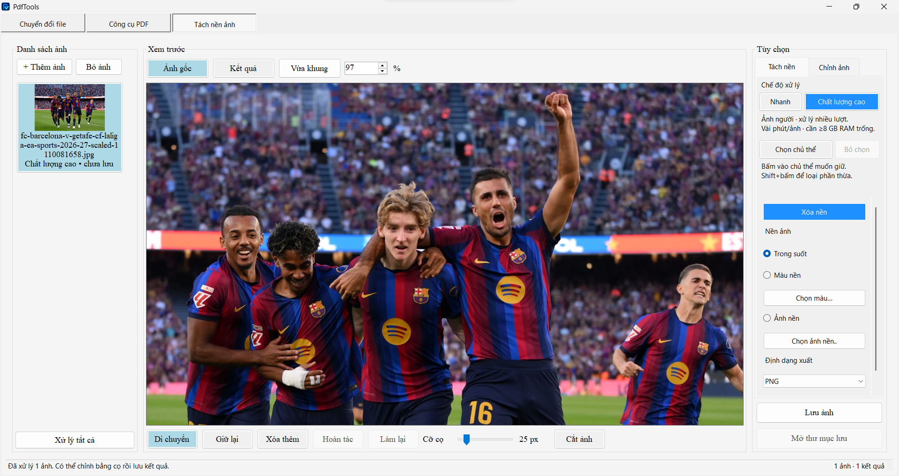
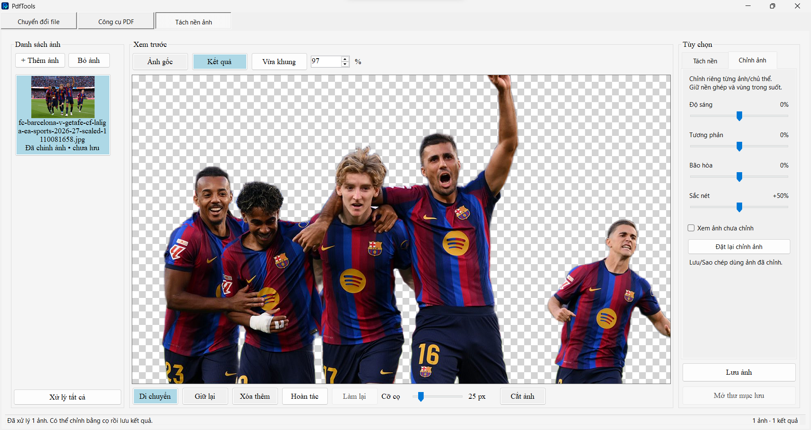
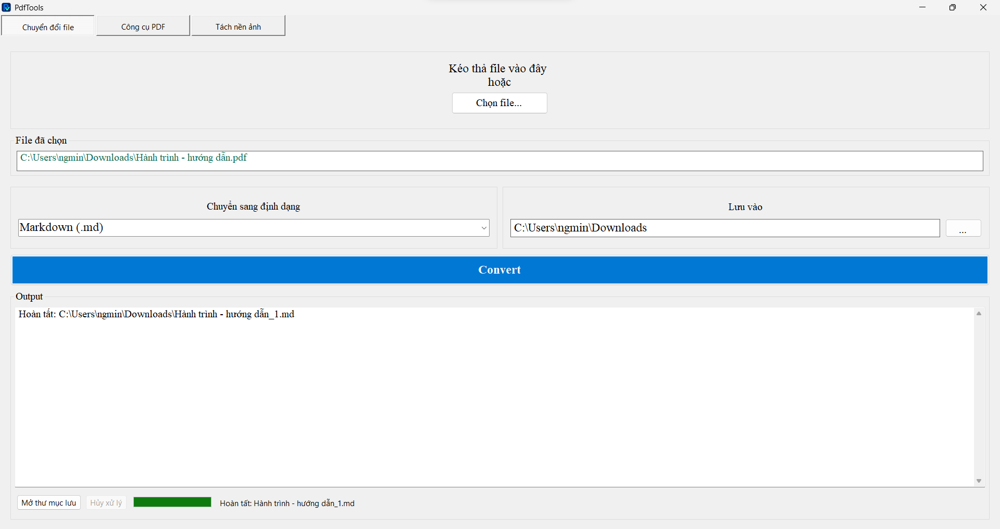

# PVTools

**Xử lý PDF và tách nền ảnh trên Windows, trong cùng một ứng dụng.**

PVTools là dự án cá nhân mình phát triển bằng C# để phục vụ học tập và công việc hằng ngày. Hai phần được tập trung phát triển là **công cụ PDF** và **tách nền, chỉnh sửa ảnh**. Ứng dụng cũng có thêm chức năng chuyển đổi file để hỗ trợ khi cần.

Các hình bên dưới là ảnh chụp trực tiếp từ ứng dụng đang chạy.

[Công cụ PDF](#công-cụ-pdf) · [Tách nền và chỉnh ảnh](#tách-nền-và-chỉnh-ảnh) · [Cài đặt](#cài-đặt)

## Công cụ PDF

Xem trước các trang, chọn phần cần xử lý và kiểm tra tài liệu trước khi xuất. Phù hợp khi cần lấy vài trang từ giáo trình, bỏ trang thừa trong báo cáo hoặc chèn thêm tài liệu vào một file PDF.

### Chỉnh sửa và xuất trang

- **Xem trước từng trang** dưới dạng ảnh thu nhỏ, kèm số trang để dễ chọn.
- **Chọn trang bằng chuột hoặc nhập dải số**, ví dụ `5-10,15`.
- **Xóa trang** đã chọn hoặc xóa theo số trang.
- **Nhân đôi trang** đã chọn.
- **Chèn file PDF** vào tài liệu đang làm việc.
- **Xuất toàn bộ tài liệu** sau chỉnh sửa hoặc chỉ xuất các trang đã chọn.
- **Hoàn tác, làm lại** và theo dõi trạng thái thay đổi chưa xuất.

### Kiểm tra tài liệu

| Mục kiểm tra | Hỗ trợ |
|---|---|
| Trang trùng lặp | Tìm các trang có hình ảnh render giống nhau để xem lại. |
| Trang trắng | Đánh dấu các trang nghi trắng để người dùng kiểm tra. |
| Chính tả Việt–Anh | Gợi ý từ nghi sai và các mục cần xem lại; không tự sửa nội dung PDF. |
| Đọc chữ | Đọc lớp văn bản có sẵn, kết hợp OCR khi trang có quá ít chữ đọc được. |

Nhấp đúp vào kết quả kiểm tra để chọn các trang liên quan hoặc xem chi tiết. Các gợi ý giúp rà soát nhanh hơn; với tài liệu có thuật ngữ chuyên ngành hoặc ảnh scan mờ, vẫn cần kiểm tra lại trước khi sửa hay xóa trang.

**Thao tác nhanh:** Chọn file PDF → chọn trang cần xử lý → chỉnh sửa hoặc bấm **Tiến hành** để kiểm tra → xuất kết quả.

## Tách nền và chỉnh ảnh

Tách người hoặc vật khỏi nền, chọn chủ thể muốn giữ và hoàn thiện ảnh ngay trong ứng dụng. Có thể dùng cho ảnh minh họa báo cáo, bài thuyết trình hoặc ảnh cần ghép sang nền khác.

### Ảnh gốc và kết quả thực tế

Ảnh nhiều người được xử lý bằng chế độ **Chất lượng cao**. Kết quả bên phải đang mở phần **Chỉnh ảnh**; nền ô bàn cờ thể hiện vùng trong suốt.

| Ảnh gốc | Sau tách nền và chỉnh ảnh |
|---|---|
|  |  |

### Nhận diện và tách nền

- **Hai chế độ xử lý:** Nhanh và Chất lượng cao để lựa chọn theo ảnh và tài nguyên máy.
- **Bấm chọn chủ thể cần giữ** khi ảnh có nhiều người hoặc vật; có thể thêm điểm giữ và điểm loại để điều chỉnh vùng chọn.
- **Cọ Giữ lại / Xóa thêm** để sửa vùng còn thiếu hoặc phần nền còn sót.
- **Xem ảnh gốc / Kết quả** để đối chiếu trong lúc chỉnh sửa.
- **Xử lý nhiều ảnh** từ danh sách ảnh đã thêm.

Phần nhận diện chạy trên máy bằng các mô hình AI đi kèm, không cần tải ảnh lên dịch vụ bên ngoài khi sử dụng chức năng tách nền.

### Hoàn thiện ảnh sau tách nền

| Chức năng | Cách dùng |
|---|---|
| Chỉnh ảnh | Điều chỉnh độ sáng, tương phản, bão hòa và sắc nét; xem tạm ảnh chưa chỉnh hoặc đặt lại thông số. |
| Cắt ảnh | Kéo cạnh hoặc góc của khung cắt, di chuyển khung rồi áp dụng. |
| Thay nền | Giữ trong suốt, chọn màu nền hoặc ghép ảnh nền khác. |
| Hoàn tác / Làm lại | Quay lại các bước chỉnh sửa trong phiên làm việc. |
| Sao chép ảnh | Đưa ảnh kết quả vào clipboard để dán vào ứng dụng hỗ trợ dán ảnh. |
| Lưu ảnh | Xuất PNG hoặc JPG; dùng PNG khi cần giữ vùng trong suốt. |

Các thông số chỉnh ảnh được giữ riêng cho từng ảnh trong phiên làm việc. Khi lưu hoặc sao chép, ứng dụng dùng ảnh đã áp dụng các thông số chỉnh sửa.

### Điều khiển trong vùng xem trước

| Thao tác | Kết quả |
|---|---|
| Cuộn chuột | Phóng to / thu nhỏ ảnh. |
| Giữ chuột phải và kéo | Di chuyển ảnh, kể cả khi đang dùng cọ. |
| Nhấp chuột phải | Mở menu xóa khỏi danh sách, cắt, sao chép hoặc lưu ảnh. |
| Bấm khi đang chọn chủ thể | Thêm điểm giữ. |
| `Shift` + bấm khi đang chọn chủ thể | Thêm điểm loại. |
| `Enter` khi cắt ảnh | Áp dụng khung cắt. |
| `Esc` khi cắt ảnh | Hủy thao tác cắt. |

**Thao tác nhanh:** Thêm ảnh → chọn chế độ → chọn chủ thể nếu cần → **Xóa nền** → chỉnh ảnh / cắt / thay nền → lưu hoặc sao chép.

Chế độ Chất lượng cao dùng nhiều RAM và xử lý lâu hơn chế độ Nhanh. Chất lượng tách nền phụ thuộc vào ảnh gốc; tóc, vật trong suốt hoặc chủ thể chồng lấp vẫn có thể cần thêm điểm chọn hay sửa bằng cọ.

## Chuyển đổi file

Tiện ích bổ sung để chọn hoặc kéo thả file, chọn định dạng đích và thư mục lưu, theo dõi kết quả xử lý. Một ví dụ là chuyển PDF sang Markdown để lấy nội dung phục vụ ghi chú hoặc biên tập tiếp.

Một số luồng chuyển đổi cần cài thêm **Pandoc**, **LibreOffice** hoặc **Microsoft Word**, tùy định dạng đầu vào và đầu ra. Các chương trình này không nằm trong bộ cài PVTools.

## Cài đặt

Ứng dụng dành cho **Windows 10/11 x64**. Các bản cài sẽ được đăng tại mục [Releases của PVTools](https://github.com/ngminhphuong116/PVTools/releases).

1. Tải bộ cài `PVTools-1.0.0-Setup-x64.exe` từ bản phát hành tương ứng.
2. Chạy bộ cài, chọn ngôn ngữ và thư mục cài đặt.
3. Nếu máy thiếu Visual C++ x64 Runtime phù hợp, cho phép gói Microsoft đi kèm cài bổ sung khi Windows yêu cầu.
4. Mở PVTools từ Start Menu hoặc shortcut Desktop.

Bộ cài đã kèm runtime .NET, các mô hình AI, dữ liệu OCR và từ điển của bản publish. Nếu dùng bản thư mục, cần giữ nguyên toàn bộ thư mục bên cạnh `PVTools.exe`.

Khi xử lý ảnh lớn bằng chế độ Chất lượng cao, nên đóng bớt ứng dụng nặng và chạy từng ảnh trước để theo dõi mức sử dụng RAM.

## Công nghệ

- **C# / .NET 8 / Windows Forms** cho ứng dụng Windows.
- **ONNX Runtime**, U²-Net, BiRefNet và MobileSAM cho tách nền, nhận diện và chọn chủ thể.
- **PDFsharp**, **PdfPig** và **PDFtoImage** cho xử lý, đọc và xem trước PDF.
- **Tesseract OCR** và từ điển **Hunspell** cho đọc chữ và hỗ trợ rà soát chính tả.
- **ClosedXML** cùng các công cụ chuyển đổi ngoài cho các luồng định dạng tương ứng.

Các thông báo và giấy phép của mô hình, thành phần bên thứ ba được lưu trong thư mục [licenses](licenses/).

## Tác giả

**[ngminhphuong116](https://github.com/ngminhphuong116)**  
Sinh viên Kỹ thuật máy tính — Đại học Công nghiệp TP.HCM (IUH).

Dự án được phát triển để thực hành lập trình và xây dựng những công cụ phục vụ học tập, công việc. Nếu gặp lỗi, bạn có thể gửi mô tả thao tác, phiên bản app và ảnh minh họa tại mục [Issues](https://github.com/ngminhphuong116/PVTools/issues).
